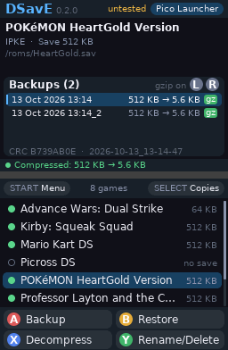
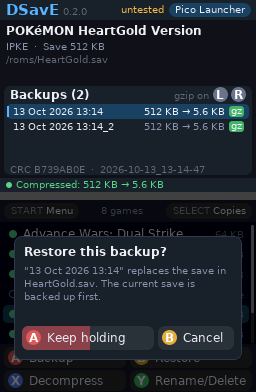
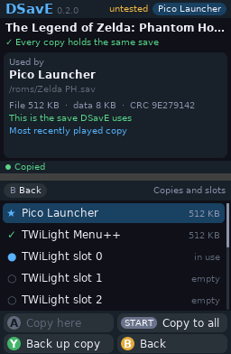
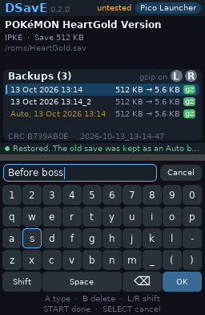

# DSavE

A save manager for the Nintendo DS family that runs on the console itself, in
the spirit of Checkpoint and JKSM. Back up, restore, name and export your game
saves without a PC.

<p>




</p>

> **Status: early.** It has not been tested on hardware yet, so keep your own
> copy of anything precious. Physical-cartridge saves are still to come (see
> [Roadmap](#roadmap)).

## What it does

- **Finds your games and their saves, whichever kernel you use.** DSavE
  detects every kernel on the card and applies each one's save rules,
  including its settings files and save slots:

  | Kernel | Detected by | Default save location |
  |---|---|---|
  | Pico Launcher (DSpico) | `_pico/` | `<rom>.sav` beside the ROM |
  | TWiLight Menu++ | `_nds/TWiLightMenu/` | `<rom folder>/saves/<rom>.sav` |
  | akmenu-next | `_nds/akmenunext/` | `<rom>.sav` beside the ROM |
  | Wood R4 *(untested)* | `__rpg/` | `<rom>.sav` beside the ROM |
  | YSMenu | `TTMenu/` | `<rom>.sav` beside the ROM |
  | AKAIO | `__aio/` | `<rom>.sav` beside the ROM |

  When several kernels share a card, pick the one you launch games with in
  the menu (START). See [docs/kernels.md](docs/kernels.md) for every rule and its
  source.

- **Keeps as many backups as you like**, each with a name (a timestamp by
  default). Backups are raw `.sav` files, so emulators and PC save editors can
  open them directly:

  ```
  _DSavE/saves/<GAMECODE> <title>/<backup name>/<title>.sav
                                               /backup.ini   (size, CRC-32, date)
  _DSavE/export/   exported copies
  _DSavE/import/   .sav files to import as backups
  _DSavE/_TRASH_/  deleted backups (nothing is ever hard-deleted)
  ```

  Games are named by their banner title in English, French, German, Italian,
  Spanish or Japanese, whichever comes first that the fonts can draw. A game
  whose banner is Japanese only is named by its ROM file name instead.

- **Restores safely.**
  1. The backup's size and CRC-32 are checked against `backup.ini`, and its
     game code must match the game. A corrupt, truncated or wrong-game
     backup is refused before anything is written.
  2. The current save is backed up automatically (`auto_<timestamp>`). Only
     the last 10 auto backups of each game are kept, and older ones go to
     `_TRASH_`. Change the number, or keep them all, with *Keep auto backups*
     in the menu.
  3. The save is overwritten in place, so flashcarts that need a contiguous,
     pre-allocated save file (Wood R4) keep working. If the kernel padded
     the save (Pico and TWiLight pad to 512 KB), the padding is kept.
  4. The result is read back and compared. If it does not match, the old save
     is put back.

- **Backs up safely.** Each backup is written to a hidden temp folder,
  verified, and only then renamed into place. A blank (all `00`/`FF`) save is
  flagged rather than silently kept.

- **Compresses backups if you want.** Turn on *Compress new backups* in the
  menu, or press X on any backup to compress or decompress it. Compressed
  backups are standard gzip files (`<title>.sav.gz`), so `gunzip` or 7-Zip on
  a PC turns them back into a raw `.sav`. A padded 512 KB save usually shrinks
  to a few KB. Saves over 1 MB stay uncompressed, because the DS Lite has
  only 4 MB of RAM.

- **Imports saves from a PC, an emulator or Checkpoint.** Put the `.sav`
  (or `.dsv`, or `.sav.gz`) in `_DSavE/import/`, choose the game, then
  *Import a .sav* under Y. The file becomes a backup named `import_<file>`,
  which you can then restore. DeSmuME's `.dsv` footer is removed. DSavE
  can't tell which game a raw `.sav` belongs to, so check you picked the right
  one. no$gba saves are not supported yet.

## Controls

Everything works with the buttons or the stylus.

**Top screen:** the selected game, its save, and its backup history.
**Bottom screen:** the game list and the action bar.

| Where | Button | Action |
|---|---|---|
| Games | Up/Down, Left/Right | Move, page (or tap and drag the list) |
| | L/R | Choose a backup in the history |
| | A | **Backup** the save now (named by date and time) |
| | B | **Restore** the chosen backup (hold A to confirm) |
| | X | **Compress** or decompress the chosen backup |
| | Y | **Rename/Delete**: rename, move to trash, export a `.sav` for PC, back up with a name, or import a `.sav` |
| | START | Menu: active kernel, compression, auto backups to keep, rescan, about |
| | SELECT | Copies of this save across kernels, and TWiLight slots |
| Copies | A on a copy | Copy the current save there (hold A) |
| | A on a slot | Make TWiLight load that slot |
| | START | Copy the current save to every kernel (hold A) |
| | Y | Back up the selected copy |
| | B | Back to the games |
| Keyboard | Tap, or d-pad and A | Type |
| | B, L/R | Delete, shift |
| | START / SELECT | Done / cancel |

## Installing and testing

1. Download `DSavE.nds` from the
   [latest release](https://github.com/JohnOnAvocados/DSavE/releases), or from
   the *DSavE* artifact of the latest
   [CI run](https://github.com/JohnOnAvocados/DSavE/actions) on `main`.
2. Copy it anywhere on your SD card, for example `_nds/DSavE.nds` or next to
   your ROMs.
3. Launch it from your kernel like any homebrew. Kernels patch DLDI for you.
4. Before trusting it with a save you care about, copy that save to a PC.
   Then work through the [hardware test checklist](docs/kernels.md#hardware-test-checklist)
   and report anything odd as a GitHub issue, with the kernel, the flashcart
   and the game.

Releases are made by pushing a tag that matches `APP_VERSION` in
`source/ui/app.h` (for example `v0.2.0`, or `v0.2.0-beta1` for a
pre-release). GitHub Actions builds the ROM and attaches it to the release.

## Building

DSavE builds with [BlocksDS](https://blocksds.skylyrac.net). With Docker:

```sh
docker run --rm -v "$PWD":/work -w /work skylyrac/blocksds:slim-latest make
```

This produces `DSavE.nds`. Copy it to your SD card and launch it from your
loader. Every push is also built by GitHub Actions; the `.nds` is attached to
each run.

The engine in `source/core/` and the UI in `source/ui/` are plain C with no
DS dependencies, so they are tested on a PC against fake SD cards:

```sh
make -C tests
```

The UI test presses buttons and taps the screen like a player would and
saves a PNG of both screens after each step in `tests/screenshots/`. CI
uploads them with each run.

The UI fonts are generated from DejaVu Sans by `tools/make_font.py` (needs
Pillow) into `source/ui/font_data.c`, which is committed.

## Roadmap

1. **Kernel profiles**: Pico Launcher, TWiLight Menu++,
   akmenu-next, Wood R4, YSMenu and AKAIO save rules, plus backup, restore,
   rename, trash and export.
2. **Cross-kernel tools**: spot out-of-sync copies of a save
   when several kernels share a card, copy a save into another kernel's
   layout, and switch TWiLight save slots.
3. **Dual-screen UI** (this release): game info and backup history on top,
   a touch list and button actions on the bottom, plus optional compressed
   backups.
4. **Release**: hardware testing on DSpico and Ace3DS X, then a tagged
   release.

Later: physical cartridge saves (DSi with Unlaunch, DS Lite hot-swap),
DSiWare `.pub`/`.prv` saves, and format conversion (`.dsv`, `.duc`, no$gba).

## License

DSavE is licensed under the GNU General Public License v3.0 or later. See
[LICENSE](LICENSE).

It includes [miniz](https://github.com/richgel999/miniz) (MIT, see
`source/third_party/miniz/LICENSE`) and glyphs rendered from
[DejaVu Sans](https://dejavu-fonts.github.io/) (Bitstream Vera license, see
`source/ui/fonts/LICENSE-DejaVu.txt`).
